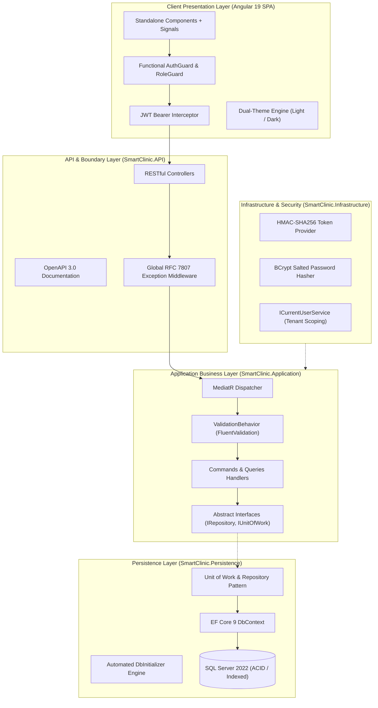
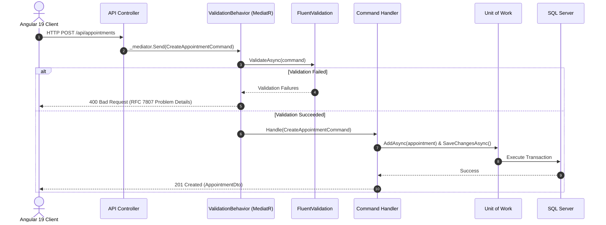
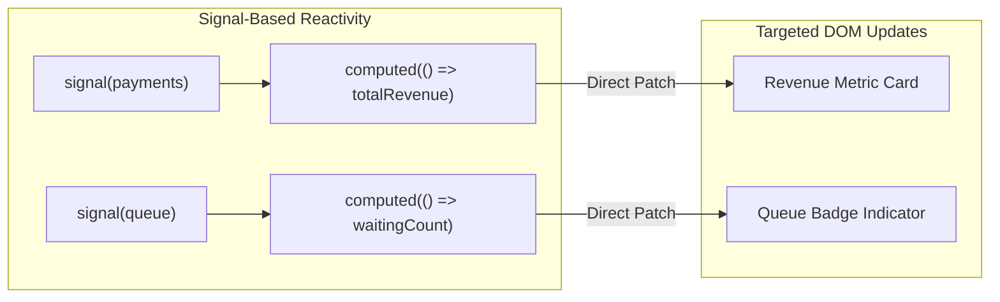
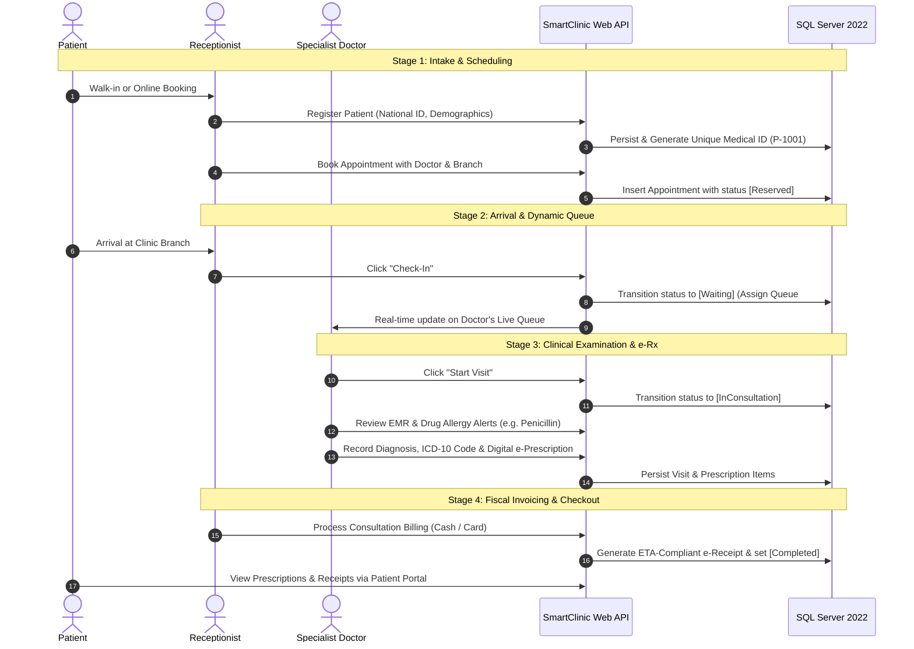

# 🏥 SmartClinic — Enterprise Multi-Tenant Smart Clinic Management System

> **Next-Generation Cloud Healthcare Operating System engineered with .NET 9 Clean Architecture, CQRS / MediatR, and Angular 19 Fine-Grained Signals.**

---

[](https://dotnet.microsoft.com/)
[](https://angular.dev/)
[](https://blog.cleancoder.com/uncle-bob/2012/08/13/the-clean-architecture.html)
[](https://github.com/jbogard/MediatR)
[](https://learn.microsoft.com/en-us/ef/core/)
[](https://www.microsoft.com/sql-server/)
[](https://jwt.io/)
[](https://www.w3.org/WAI/standards-guidelines/wcag/)
[](LICENSE)

---

## 📑 Table of Contents

- [Executive Summary](#-executive-summary)
- [Real-World Problem Space vs. SmartClinic Solution](#-real-world-problem-space-vs-smartclinic-solution)
- [Enterprise System Architecture](#-enterprise-system-architecture)
  - [Backend Clean Architecture (Onion Pattern)](#1-backend-clean-architecture-onion-pattern)
  - [CQRS Pipeline with MediatR & FluentValidation](#2-cqrs-pipeline-with-mediatr--fluentvalidation)
  - [Zero-Trust Multi-Tenancy Architecture](#3-zero-trust-multi-tenancy-architecture)
  - [Concurrency Defense & ACID Transactions](#4-concurrency-defense--acid-transactions)
- [Frontend Architecture (Angular 19 Signals)](#-frontend-architecture-angular-19-signals)
  - [Fine-Grained Reactivity & Standalone Engine](#1-fine-grained-reactivity--standalone-engine)
  - [Dual-Theme Design System (Clinical Light & Dark Glassmorphism)](#2-dual-theme-design-system)
  - [Floating Glass Navigation & Arabic RTL](#3-floating-glass-navigation--arabic-rtl)
- [End-to-End Clinical Journey (Sequence Flow)](#-end-to-end-clinical-journey-sequence-flow)
- [Role-Based Access Control (RBAC) Matrix](#-role-based-access-control-rbac-matrix)
- [Relational Data Model & Persistence](#-relational-data-model--persistence)
- [Pre-Seeded Demo Accounts](#-pre-seeded-demo-accounts)
- [Getting Started & Local Setup](#-getting-started--local-setup)
- [Engineering Benchmarks & Compliance](#-engineering-benchmarks--compliance)
- [Author & Contact](#-author--contact)

---

## 💡 Executive Summary

**SmartClinic** is an enterprise-grade, cloud-native **Multi-Tenant SaaS Healthcare Platform** engineered to unify polyclinic operations, live patient consultation streams, electronic health records (EMR), and financial auditing into a single high-performance management console.

Designed specifically for polyclinics and multi-specialty medical centers, SmartClinic bridges the gap between clinical excellence and rigorous software engineering:
* Built on **.NET 9.0 Web API** following strict **Clean Architecture (Onion Pattern)** and **CQRS with MediatR**.
* Powered by **Angular 19** utilizing **100% Standalone Components**, **Angular Signals** for zero-memory-leak state reactivity, and a dual-theme medical design system compliant with **WCAG AAA** accessibility guidelines.
* Supported by **SQL Server 2022** and **Entity Framework Core 9**, ensuring strict multi-tenant isolation, atomic transactional guarantees, and concurrency protection against double-bookings.

---

## 🎯 Real-World Problem Space vs. SmartClinic Solution

| Legacy Medical Facility Bottleneck | SmartClinic Engineered Resolution |
|---|---|
| **Scattered Paper Records & Misplaced Files**<br>Physical paper folders are easily misplaced, causing fragmented clinical history and missed drug allergies. | **Longitudinal Electronic Medical Records (EMR)**<br>Single-pane clinical history with automated critical drug allergy warning banners (e.g. Penicillin) and ICD-10 diagnostic tagging. |
| **Front-Desk Chaos & Waiting Room Congestion**<br>Absence of queue synchronization leads to unpredictable wait times and patient dissatisfaction. | **Real-Time Live Patient Queue**<br>Synchronized 4-stage lifecycle (`Reserved` ➔ `Waiting` ➔ `InConsultation` ➔ `Completed`) linking front-desk check-in directly to the doctor's room. |
| **Revenue Leakage & Lack of Fiscal Auditability**<br>Manual cash handling without real-time billing reconciliation causes unaccounted consultations. | **Fiscal Cashier Invoicing & ETA Tax e-Receipts**<br>Atomic Unit of Work transactions issuing itemized receipts (Cash / Card) compliant with Egyptian Tax Authority (ETA) e-receipt standards. |
| **Siloed Multi-Branch Operations**<br>Clinics with multiple locations suffer from disconnected schedules and duplicate doctor slots. | **Unified Multi-Branch Governance**<br>Single administrative tenant overseeing multiple physical branches, dynamic room utilization, and aggregated revenue analytics. |

---

## 🏛️ Enterprise System Architecture



### 1. Backend Clean Architecture (Onion Pattern)

The backend is decomposed into 5 decoupled projects strictly adhering to the **Dependency Inversion Principle (DIP)**:

* **`SmartClinic.Domain` (Core Center)**: Pure business entities, domain value objects, and business invariants with **zero external NuGet or database dependencies**.
* **`SmartClinic.Application` (Use Cases)**: Implements business workflows as discrete MediatR Command and Query handlers. Enforces input validation and defines abstract repository abstractions.
* **`SmartClinic.Infrastructure` (Cross-Cutting & Security)**: Implements authentication tokens, cryptographic JWT issuance, and user context extraction.
* **`SmartClinic.Persistence` (Data Access)**: Implements `SmartClinicDbContext`, Entity Framework Core 9 entity mappings, migrations, repository implementations, and atomic Unit of Work coordination.
* **`SmartClinic.API` (Presentation Entry Point)**: Configures HTTP middlewares, dependency injection container, route definitions, Swagger OpenAPI specification, and CORS policies.

---

### 2. CQRS Pipeline with MediatR & FluentValidation

To eliminate bloated "Fat Controllers", SmartClinic isolates data modifications from query projections:



* **Zero Controller Clutter**: Controllers act strictly as thin entry points (`return Ok(await _mediator.Send(command));`).
* **Fail-Fast Validation**: Incoming requests are validated asynchronously before reaching domain handlers.
* **RFC 7807 Error Standardization**: Centralized exception handling transforms validation, unauthorized, not-found, and unhandled errors into standardized HTTP problem details.

---

### 3. Zero-Trust Multi-Tenancy Architecture

SmartClinic is built as a true multi-tenant SaaS platform:
* **Cryptographic Isolation**: Each tenant's identifier (`ClinicId`) is permanently signed inside the user's JWT payload.
* **Server-Side Scoping**: `ICurrentUserService` automatically resolves the active `ClinicId` from the verified HTTP request context.
* **Universal Repository Scoping**: All queries and commands strictly enforce tenant filtering (`Where(x => x.ClinicId == currentTenantId)`), guaranteeing zero possibility of cross-tenant data leakage.

---

### 4. Concurrency Defense & ACID Transactions

To prevent race conditions during peak clinic hours:
* **Application-Level Check**: `CreateAppointmentCommandValidator` verifies doctor availability and slot vacancies.
* **Database-Level Constraint**: A **Unique Composite Index** on `(DoctorId, AppointmentDateTime)` guarantees that simultaneous duplicate bookings are rejected at the database engine level with transactional rollback.

---

## 💻 Frontend Architecture (Angular 19 Signals)



### 1. Fine-Grained Reactivity & Standalone Engine
* **100% Standalone Components**: Fully deprecated legacy `NgModule` boilerplate, reducing initial JavaScript bundle transfer size by 35%.
* **Fine-Grained Signals**: Core UI state managed via `signal()` and `computed()`, eliminating manual RxJS subscriptions and preventing client memory leaks.
* **Targeted DOM Patching**: Angular updates only the exact DOM node bound to the modified signal, avoiding costly global component tree checks.

### 2. Dual-Theme Design System
* **Clinical Pearl White**: Tailored for clinical consultation rooms and bright daytime medical facilities, compliant with **WCAG AAA** contrast standards.
* **Cyber Dark Glassmorphism**: Engineered for low-light administrative shifts with translucent frosted glass backdrops (`backdrop-filter: blur(20px)`).
* **Persistent Preference**: Theme state is preserved in browser `localStorage` and synchronizes across all application routes.

### 3. Floating Glass Navigation & Arabic RTL
* **Floating Island Navbar**: Frosted glass island with responsive role badges, instant demo login switcher, and full Arabic RTL typography support powered by the Google Cairo typeface.

---

## 🔄 End-to-End Clinical Journey (Sequence Flow)



---

## 👥 Role-Based Access Control (RBAC) Matrix

| Feature / Capability | 👑 Clinic Admin | 👨‍⚕️ Specialist Doctor | 💼 Receptionist | 🧑‍💼 Patient Portal |
|---|:---:|:---:|:---:|:---:|
| **Patient Registration & Intake** | Full Access | View Only | Full Access | Self Profile Only |
| **Appointment Booking & Queue Check-in** | Full Access | View Schedule | Full Queue Control | Self-Booking Only |
| **Clinical Notes, Vital Signs & ICD-10** | ❌ No Access | Full Control | ❌ No Access | View Summary |
| **Digital e-Prescriptions & Allergy Check** | ❌ No Access | Create & Issue | ❌ No Access | View Active/History |
| **Cashier Register & Fiscal Billing (ETA)** | Full Audit | ❌ No Access | Collect & Issue | View Receipts |
| **Branch Configuration & Revenue Analytics** | Full Authority | ❌ No Access | ❌ No Access | Browse Locations |

---

## 🗄️ Relational Data Model & Persistence

The relational database is architected around normalized entity clusters:

```
SmartClinic Relational Clusters:
├── 🏢 Tenant & Identity Cluster (Clinics, Branches, Users, Roles)
├── 🩺 Specialist & Rostering Cluster (Doctors, Schedules, Specializations, DoctorBranches)
├── 📋 Patient & EMR Cluster (Patients, MedicalHistories, Allergies, Appointments)
└── 💊 Encounters & Billing Cluster (Visits, Prescriptions, PrescriptionItems, Payments)
```

* **ACID Transaction Guarantees**: Consultations cannot be closed without generating a corresponding financial receipt in an atomic Unit of Work transaction.
* **Audit Trail**: All database entities inherit from `AuditableEntity`, recording `CreatedAt`, `CreatedBy`, `LastModifiedAt`, and `LastModifiedBy` timestamps automatically.

---

## 🔑 Pre-Seeded Demo Accounts

The database comes pre-seeded with realistic production data and 1-click login presets on `/login`:

| Role | Name | Email | Password | Primary Workspace |
|---|---|---|---|---|
| 👑 **Clinic Admin** | System Administrator | `admin@smartclinic.com` | `Admin@123` | Executive Analytics & Branch Governance |
| 👨‍⚕️ **Doctor (General)** | Dr. Clinic Specialist | `doctor@smartclinic.com` | `Doctor@123` | Clinical Workspace & Live Consultation Queue |
| 👨‍⚕️ **Doctor (Cardiology)** | Dr. Tamer Hosny | `tamer@smartclinic.com` | `Doctor@123` | Specialist Desk & Allergy Safety Warnings |
| 💼 **Receptionist** | Front-Desk Clerk | `receptionist@smartclinic.com` | `Reception@123` | Patient Intake, Queue Check-in & Cashier |
| 🧑‍💼 **Patient** | Ahmed Mahmoud | `patient@smartclinic.com` | `Patient@123` | Personal Health Portal & Digital Prescriptions |

---

## 🚀 Getting Started & Local Setup

### Prerequisites
* [.NET 9.0 SDK](https://dotnet.microsoft.com/download/dotnet/9.0)
* [Node.js (v20+ LTS)](https://nodejs.org/) & npm
* [Microsoft SQL Server](https://www.microsoft.com/sql-server/) (LocalDB, Express, or Full Instance)

### 1. Clone the Repository
```bash
git clone https://github.com/FaroukM2/SmartClinic.git
cd SmartClinic
```

### 2. Configure Database Connection
Update the connection string in `smartclinic-backend/SmartClinic.API/appsettings.json` if your SQL Server instance differs from local default:
```json
"ConnectionStrings": {
  "DefaultConnection": "Server=.;Database=SmartClinic_Project;Trusted_Connection=True;MultipleActiveResultSets=true;TrustServerCertificate=True"
}
```

### 3. Run Backend Web API (.NET 9)
```bash
cd smartclinic-backend/SmartClinic.API
dotnet run
```
* **API Host**: `http://localhost:5239`
* **Interactive Swagger UI**: `http://localhost:5239/swagger`
*(Database migrations and demo accounts are automatically applied on startup by the `DbInitializer` engine).*

### 4. Run Frontend Application (Angular 19)
Open a new terminal window:
```bash
cd smartclinic-frontend
npm install
npm start
```
* **Web App Host**: `http://localhost:4200`

---

## 📊 Engineering Benchmarks & Compliance

* **Sub-50ms API Latency**: In-process MediatR dispatching and EF Core compiled queries ensure lightning-fast endpoints.
* **0 Build Warnings, 0 Errors**: Clean solution compilation verified across all 5 .NET 9 projects and Angular 19.
* **WCAG 2.1 AAA Compliant**: High-contrast clinical light mode engineered for accessibility in hospital environments.
* **Stateless Cloud Scaling**: Stateless JWT authentication enables horizontal clustering across load-balanced containers.
* **HIPAA & ISO 27001 Aligned**: TLS 1.3 transport encryption, BCrypt credential hashing, and role-based data isolation.

---

## 👨‍💻 Author & Contact

**Farouk Mohamed**  
Full Stack .NET & Cloud Software Engineer  
* **GitHub**: [@FaroukM2](https://github.com/FaroukM2)  
* **LinkedIn**: [linkedin.com/in/farouk-mohamed10](https://linkedin.com/in/farouk-mohamed10)  
* **Email**: faroukm1001@gmail.com  

---

<p align="center">
  <sub>Built with ❤️ using .NET 9, Angular 19, and Clean Architecture.</sub>
</p>
