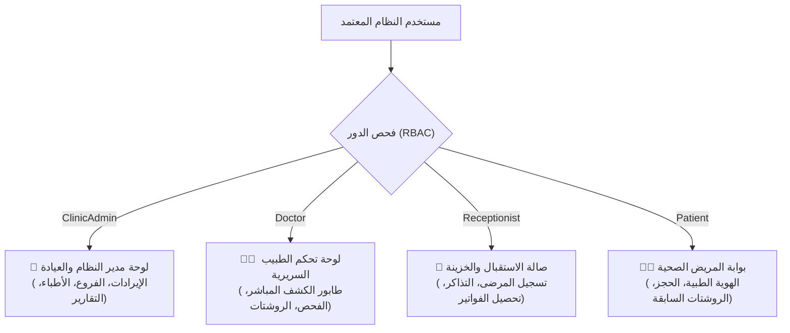
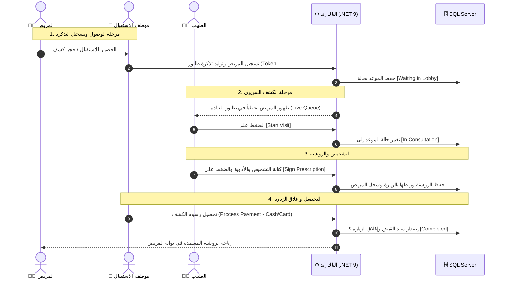
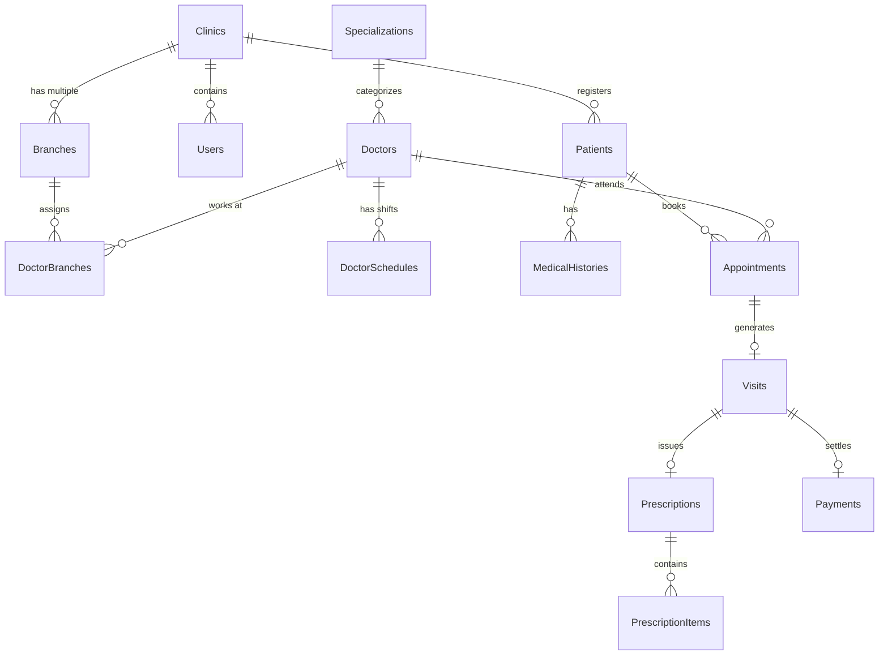

# 🏥 SmartClinic — Enterprise Multi-Tenant Smart Clinic Management System
### 📖 الوثيقة الهندسية الشاملة والدليل المرجعي للمشروع (Master Technical Documentation)

---

## 📌 الفهرس العام (Table of Contents)

1. [💡 الملخص التنفيذي ورؤية المشروع (Executive Summary)](#1--الملخص-التنفيذي-ورؤية-المشروع-executive-summary)
2. [🏛️ المعمارية الهندسية والتقنيات (Architecture & Tech Stack)](#2-%EF%B8%8F-المعمارية-الهندسية-والتقنيات-architecture--tech-stack)
3. [👥 منظومة الأدوار والصلاحيات الأربعة (The 4 Distinct User Roles & RBAC)](#3--منظومة-الأدوار-والصلاحيات-الأربعة-the-4-distinct-user-roles--rbac)
4. [🔄 دورة حياة الكشف الطبي المتكاملة (End-to-End Patient Journey)](#4--دورة-حياة-الكشف-الطبي-المتكاملة-end-to-end-patient-journey)
5. [🗄️ نموذج قاعدة البيانات والكيانات (Database Schema & Domain Model)](#5-%EF%B8%8F-نموذج-قاعدة-البيانات-والكيانات-database-schema--domain-model)
6. [🎨 نظام الواجهات وتجربة المستخدم (UI/UX & Design System)](#6--نظام-الواجهات-وتجربة-المستخدم-uiux--design-system)
7. [🔑 مصفوفة حسابات الدخول التجريبية (Pre-Seeded Accounts Matrix)](#7--مصفوفة-حسابات-الدخول-التجريبية-pre-seeded-accounts-matrix)
8. [🚀 دليل التشغيل السريع بنقرة واحدة (Quick Start & Run Guide)](#8--دليل-التشغيل-السريع-بنقرة-واحدة-quick-start--run-guide)
9. [🛡️ معايير الأمان والجودة والاعتماد المؤسسي (Enterprise Compliance)](#9-%EF%B8%8F-معايير-الأمان-والجودة-والاعتماد-المؤسسي-enterprise-compliance)

---

## 1. 💡 الملخص التنفيذي ورؤية المشروع (Executive Summary)

**SmartClinic** هو نظام سحابي متكامل لإدارة العيادات والمراكز والمجمعات الطبية متعددة الفروع والمستأجرين (**Enterprise Multi-Tenant SaaS Platform**) تم بناؤه وفق أعلى المعايير البرمجية والهندسية للأنظمة الطبية الضخمة (**HealthTech Enterprise Standards**).

### 🎯 التحديات الواقعية التي يعالجها النظام:
1. **عشوائية الحجوزات وتكدس المرضى في صالات الانتظار:** غياب الربط اللحظي المتزامن بين مكتب الاستقبال وغرف كشف الأطباء.
2. **فقدان التاريخ المرضي وحساسيات الأدوية:** الاعتماد على الدفاتر الورقية مما قد يهدد حياة المريض عند وصف دواء يتعارض مع حالته (مثل حساسية البنسلين).
3. **تعدد الفروع وصعوبة الإشراف المالي المركزي:** غياب رؤية لحظية موحدة لإيرادات كل فرع، وجداول الأطباء، ونسب الإشغال.
4. **الخلط في الصلاحيات:** إمكانية اطلاع موظفي الاستقبال أو غير المصرح لهم على الأسرار والتشخيصات الطبية، أو تعديل الأطباء لبيانات مالية لا تخصهم.

### 🌟 الحلول الذكية التي يقدمها SmartClinic:
- **عزل سحابي تام لكل عيادة (Multi-Tenancy):** بيانات كل عيادة وفروعها معزولة برمجياً ومنطقياً في قاعدة البيانات.
- **طابور انتظار حي متزامن (Live Clinic Queue):** ينقل المريض لحظياً: (حجز ➔ انتظار بالاستقبال ➔ داخل غرفة الكشف ➔ إصدار الروشتة ➔ التحصيل والمغادرة).
- **ملف طبي إلكتروني معتمد (Certified EMR):** يحفظ الأمراض المزمنة، الحساسيات الدوائية، التشخيص السريري، والتاريخ المرضي.
- **روشتات رقمية قابلة للطباعة (Printable E-Prescriptions):** تحدد الدواء، الجرعة، التكرار، والمدة مع توقيع إلكتروني للطبيب.
- **خزينة وسندات قبض إلكترونية (Billing & Invoicing):** تحصيل نقدي وبطاقات مع إصدار إيصالات جاهزة لمنظومة الضرائب.

---

## 2. 🏛️ المعمارية الهندسية والتقنيات (Architecture & Tech Stack)

تم بناء النظام وفق معمارية برمجية صارمة تفصل بين المسؤوليات وتضمن أعلى درجات الأداء وقابلية التوسع:

```
[ Angular 19 Frontend (Signals + Standalone + SCSS) ]
                         │
                    HTTPS / REST API
                         ▼
[ ASP.NET Core 9.0 Web API (Controllers + JWT + Swagger) ]
                         │
                  MediatR Pipeline
                         ▼
[ Core Application Layer (Commands, Queries, Validators, DTOs) ]
                         │
              Domain Entities & Business Rules
                         │
[ Persistence Layer (EF Core 9.0 + Multi-Tenant DB Context) ]
                         ▼
[ Microsoft SQL Server Database (SmartClinic_Project) ]
```

### 1. تقنيات الخادم والباك إند (Backend):
- **الإطار البرمجي:** .NET 9.0 (C# 13).
- **نمط المعمارية:** **Clean Architecture** (مقسم إلى: `Domain`, `Application`, `Infrastructure`, `Persistence`, `API`, `Shared`).
- **نمط معالجة البيانات:** **CQRS (Command Query Responsibility Segregation)** عبر مكتبة **MediatR**.
- **طبقة قاعدة البيانات:** **Entity Framework Core 9.0** بنمط **Code-First** ومهاجرات ترحيل البيانات (Migrations).
- **محرك قاعدة البيانات:** **Microsoft SQL Server (MSSQL)** عبر قاعدة بيانات `SmartClinic_Project`.
- **التوثيق والحماية:** **JWT Bearer Tokens** مع تشفير خوارزمية `HMAC-SHA256` وسياسات **RBAC**.

### 2. تقنيات الواجهة الأمامية (Frontend):
- **الإطار البرمجي:** **Angular 19.2** (أحدث إصدار رسمي).
- **إدارة الحالة:** **Angular Signals & Computed Signals** لتحديث الشاشات والـ Live Queue لحظياً بدون إعادة تحميل (Zero Zone.js overhead).
- **البنية الهيكلية:** **Standalone Components** بنظام التحميل الكسول (**Lazy-Loaded Routes**).
- **التصميم:** **Modern HealthTech UI** مع دعم مزدوج للوضع الليلي والنهاري السريري (**Clinical Light Mode & Dark Luxury**) ودعم كامل للغة العربية (**RTL**).
- **الرسوم البيانية:** رسوم بيانية تفاعلية SVG مخصصة لرصد الإيرادات وتدفق المرضى.

---

## 3. 👥 منظومة الأدوار والصلاحيات الأربعة (The 4 Distinct User Roles & RBAC)

يمتلك كل مستخدم في النظام واجهة مخصصة بالكامل لطبيعة عمله وصلاحيات محمية على مستوى الواجهة والخادم:



### 1. 👑 مدير العيادة (Clinic Admin):
* **الصلاحيات الحصرية:**
  * إضافة الأطباء الجدد حصرياً، تحديد أرقام تراخيصهم، وتعيينهم في الفروع وتحديد أسعار كشوفاتهم.
  * إدارة وتوسيع الفروع الجغرافية للمركز الطبي.
  * الاطلاع الكامل على إجمالي الإيرادات المالية وسندات القبض ومؤشرات الأداء (KPIs).
* **الشاشة الرئيسية:** لوحة قيادة شاملة تضم الرسوم البيانية التفاعلية لحركة المرضى، ومؤشرات إشغال الفروع ونسب استيعاب العيادات.

### 2. 👨‍⚕️ الطبيب (Doctor):
* **الهدف:** ممارسة الفحص الطبي والتشخيص وإصدار الروشتات فقط دون أي أعباء إدارية أو مالية.
* **حجب البيانات المالية:** الطبيب لا يرى إيرادات المركز أو أرباح الفروع ولا يستطيع إضافة أطباء آخرين.
* **الشاشة السريرية:**
  * **Live Patient Queue:** طابور مباشر لمرضى اليوم مع زر **`Start Visit`** لنقل المريض لغرفة الكشف.
  * فحص العلامات الحيوية (الضغط، النبض، الحرارة) والتحذير من الحساسيات الدوائية المسجلة في ملف المريض.
  * **Digital Rx Builder:** نافذة سريعة لإضافة الأدوية بالجرعة والمدة، والتوقيع الرقمي على الروشتة وإغلاق الزيارة.

### 3. 💼 موظف الاستقبال (Receptionist):
* **الهدف:** إدارة حركة الصالة، استقبال المرضى، والتحصيل المالي.
* **المهام التشغيلية:**
  * تسجيل المرضى الجدد (Walk-in Intake) وتوليد كود طبي فوري لهم.
  * حجز المواعيد وإصدار أرقام التذاكر (**Queue Token #A-10x**).
  * تحصيل رسوم الكشف (نقداً أو بالبطاقة/مدى) وإصدار إيصالات القبض الرسمية.

### 4. 🧑‍💼 المريض (Patient):
* **الهدف:** المتابعة الصحية الذاتية وحجز المواعيد.
* **الميزات المتاحة:**
  * **بطاقة الهوية الطبية الرقمية (Digital Medical ID):** تضم كود المريض، فصيلة الدم، وتنبيهات الحساسية الدوائية.
  * بطاقة الموعد القادم مع اسم الطبيب، التخصص، ورقم الدور في الطابور.
  * استعراض أرشيف الروشتات الرقمية السابقة مع تفاصيل الجرعات.

---

## 4. 🔄 دورة حياة الكشف الطبي المتكاملة (End-to-End Patient Journey)

توضح دورة العمل التالية كيفية تحرك المريض داخل المركز الطبي وتزامن البيانات بين كافة الأدوار:



---

## 5. 🗄️ نموذج قاعدة البيانات والكيانات (Database Schema & Domain Model)

تتوزع قاعدة البيانات (`SmartClinic_Project`) عبر مجموعات جداول مترابطة بعلاقات تكاملية:



### أهم الجداول في قاعدة البيانات:
1. **`Users` & `Roles` & `UserRoles`:** منظومة الهوية، التشفير بـ Salt، والأدوار الأربعة.
2. **`Clinics` & `Branches`:** المنشأة الطبية المعزولة سحابياً، وفروعها الجغرافية.
3. **`Doctors` & `DoctorBranches` & `DoctorSchedules`:** بيانات الأطباء، التراخيص، مواعيد الدوام، وأسعار الكشوفات.
4. **`Patients` & `MedicalHistories`:** سجلات المرضى والأكواد الطبية الفريدة والحساسيات المسجلة.
5. **`Appointments` & `Visits`:** جدول المواعيد، حالة الدور، والزيارة السريرية الفعلية والتشخيص.
6. **`Prescriptions` & `PrescriptionItems`:** الروشتات الرقمية وجدول الأدوية والجرعات والمدة.
7. **`Payments`:** سندات القبض وطرق السداد (Cash/Card) والإيصالات المالية.

---

## 6. 🎨 نظام الواجهات وتجربة المستخدم (UI/UX & Design System)

تم تصميم واجهات SmartClinic لتجمع بين الفخامة المعاصرة والانضباط الطبي السريري:

### 1. شريط التنقل الزجاجي العائم (Floating Island Navbar):
* تصميم كبسولي عائم (`rounded-full`) بحدود زجاجية دقيقة (`backdrop-blur-md`) يفصل بدقة بين الهوية وروابط التنقل وأزرار التحكم.
* **كبسولة الأدوات الموحدة (`Utility Capsule`):** دمج زر تبديل الثيم واللغة في كبسولة موحدة واحدة: `[ ☀️ | عربي ]`.

### 2. الوضع المزدوج (Clinical Light & Dark Luxury):
* **الوضع النهاري السريري (Clinical Light Mode):** مصمم خصيصاً للعيادات والمستشفيات نهاراً: أسطح بيضاء ناصعة (`#FFFFFF`)، حدود رمادية Slate هادئة، ونصوص عالية التباين متوافقة مع معايير الوصول العالمية (**WCAG AAA**).
* **الوضع الليلي الفاخر (Dark Luxury Mode):** أسطح كحلية داكنة راقية (`#0F172A`) بظلال ناعمة وإضاءة مريحة للعين.
* **الحفظ التلقائي:** يتم حفظ الثيم واللغة المفضلين في `localStorage` ليظلا ثابتين عند التنقل أو إعادة التحميل.

### 3. دعم كامل للغة العربية (Native RTL & Typography):
* التبديل الفوري بنقرة واحدة إلى الاتجاه الأيمن الكامل (**RTL**).
* اعتماد خط **Cairo** عالي الفخامة والوضوح المعتمد في كبرى المنصات الطبية والحكومية.

---

## 7. 🔑 مصفوفة حسابات الدخول التجريبية (Pre-Seeded Accounts Matrix)

تم تزويد النظام بحسابات تجريبية شاملة تغطي كافة الأدوار، كما زُوّدت شاشة الدخول (`/login`) بـ **أزرار الدخول السريع بنقرة واحدة (1-Click Preset Pills)**:

| الدور (Role) | الاسم في النظام | البريد الإلكتروني (Email) | كلمة المرور (Password) | الشاشة التي تفتح له فوراً |
|---|---|---|---|---|
| 👑 **Clinic Admin** | System Administrator | `admin@smartclinic.com` | `Admin@123` | لوحة المدير والإيرادات والفروع والأطباء |
| 👨‍⚕️ **Doctor** | Dr. Clinic Specialist | `doctor@smartclinic.com` | `Doctor@123` | لوحة الطبيب وطابور الكشف وزر *Start Consultation* |
| 💼 **Receptionist** | Front Desk Receptionist | `receptionist@smartclinic.com` | `Reception@123` | صالة الاستقبال وتسجيل المرضى والتحصيل |
| 🧑‍💼 **Patient** | Ahmed Mahmoud (Patient) | `patient@smartclinic.com` | `Patient@123` | بوابة المريض والهوية الطبية والروشتات السابقة |

---

## 8. 🚀 دليل التشغيل السريع بنقرة واحدة (Quick Start & Run Guide)

### 1. تشغيل النظام عبر الملفات التنفيذية السريعة:
في المجلد الرئيسي للمشروع، ستجد ملفين تشغيليين جاهزين:
* **لتشغيل خادم الباك إند (.NET 9):**  
  انقر نقراً مزدوجاً على: `run-backend.bat` ➔ يعمل على الرابط: `http://localhost:5239` (وتوثيق Swagger على `http://localhost:5239/swagger`).
* **لتشغيل خادم الفرونت إند (Angular 19):**  
  انقر نقراً مزدوجاً على: `run-frontend.bat` ➔ يعمل على الرابط: `http://localhost:4200`.

### 2. أوامر التشغيل عبر الطرفية (CLI):
```bash
# 1. تشغيل الباك إند (.NET 9 Web API)
cd smartclinic-backend\SmartClinic.API
dotnet run --launch-profile http

# 2. تشغيل الفرونت إند (Angular 19)
cd smartclinic-frontend
npm start
```

---

## 9. 🛡️ معايير الأمان والجودة والاعتماد المؤسسي (Enterprise Compliance)

تم تصميم النظام ليتوافق مع اللوائح والاشتراطات الرسمية للمنصات الصحية:

1. 🛡️ **معايير خصوصية البيانات الصحية (HIPAA Privacy Safeguards):** عزل تام للبيانات مع تشفير شامل لسجلات المرضى الحساسة.
2. 🏛️ **إدارة أمن المعلومات (ISO 27001 Aligned):** سجل تدقيق ومراقبة رقمي صارم (**Audit Logs**) لكافة الحركات والعمليات لمنع التلاعب.
3. 📑 **الربط مع منظومة الإيصال والفاتورة الإلكترونية (ETA Ready):** جاهزية كاملة لفوترة الكشوفات وسندات القبض وفق اشتراطات مصلحة الضرائب المصرية وهيئة الزكاة (ZATCA).
4. 🩺 **التوافق مع المعايير الطبية الدولية (HL7 / FHIR Standards):** استخدام ترميزات قياسية معتمدة لتشخيصات الأمراض (**ICD-10**) وتعارضات الأدوية.
5. 📈 **معايير محركات البحث (Medical SEO & Schema.org):** تضمين بيانات هيكلية رسمية من نوع `MedicalClinic` و `SoftwareApplication` لضمان أعلى ثقة وأسبقية في تصنيف نتائج بحث جوجل.
